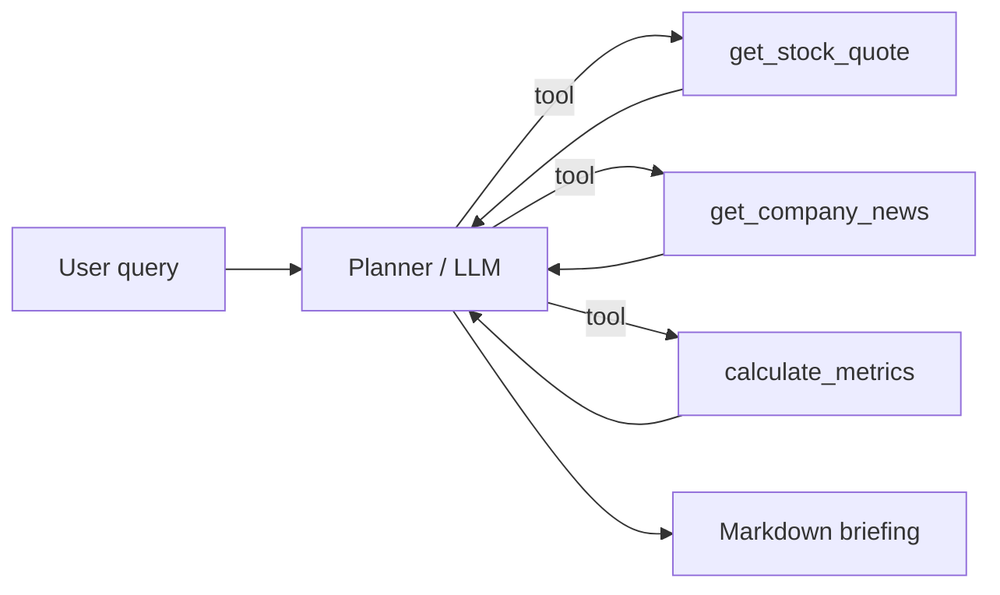

**Live demo:** [market-analyst-agent-smoky.vercel.app](https://market-analyst-agent-smoky.vercel.app)

# Market Analyst Agent

Tool-calling research agent that accepts a market query, decides which tools to run (quote → news → metrics), and returns a structured investment briefing.

> Not financial advice. Demo / portfolio project.

## Architecture



## Features

- ReAct-style tool loop (OpenAI when `OPENAI_API_KEY` is set)
- Deterministic **mock planner** when no key is present (still hits live Yahoo quote/news APIs)
- FastAPI web UI + JSON API + CLI
- Dark teal UI aligned with a recruiter portfolio aesthetic

## Quick start

```bash
python -m venv .venv
source .venv/bin/activate
pip install -r requirements.txt
cp .env.example .env

# CLI (works with zero keys)
python cli.py "Analyze NVDA"

# Web UI
uvicorn app.main:app --reload --port 8000
# open http://127.0.0.1:8000
```

## API

`POST /api/analyze`

```json
{ "query": "Analyze AAPL for a quick investment briefing" }
```

## Environment

See `.env.example`.

| Variable | Purpose |
| --- | --- |
| `OPENAI_API_KEY` | Enables LLM tool-calling mode |
| `OPENAI_MODEL` | Default `gpt-4o-mini` |
| `FORCE_MOCK` | `1` forces rule-based planner |

## Deploy

- **Local / any VM:** `uvicorn app.main:app --host 0.0.0.0 --port 8000`
- **Vercel:** this repo includes a Python serverless entry under `api/` (see `vercel.json`)

## Author

[Vagish Sharma](https://github.com/VagishSharma01) · https://vagish-sharma.vercel.app
